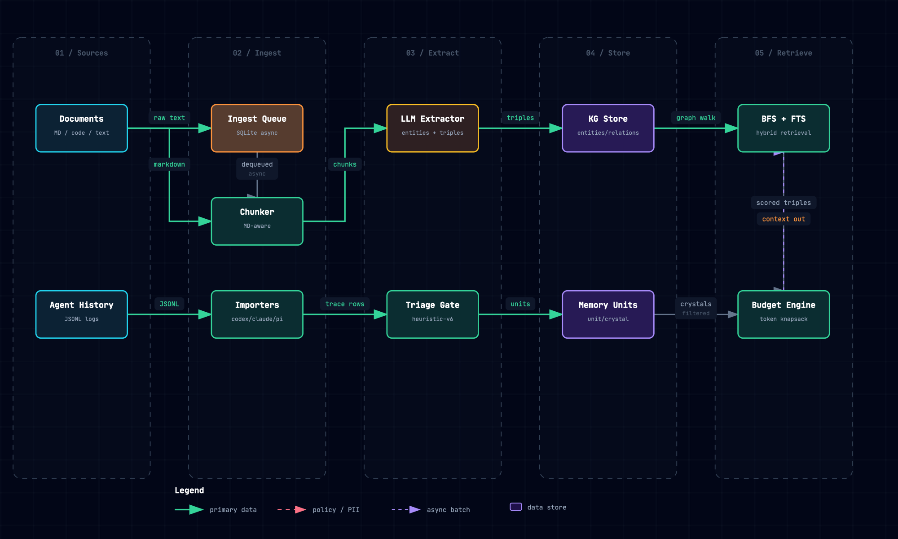
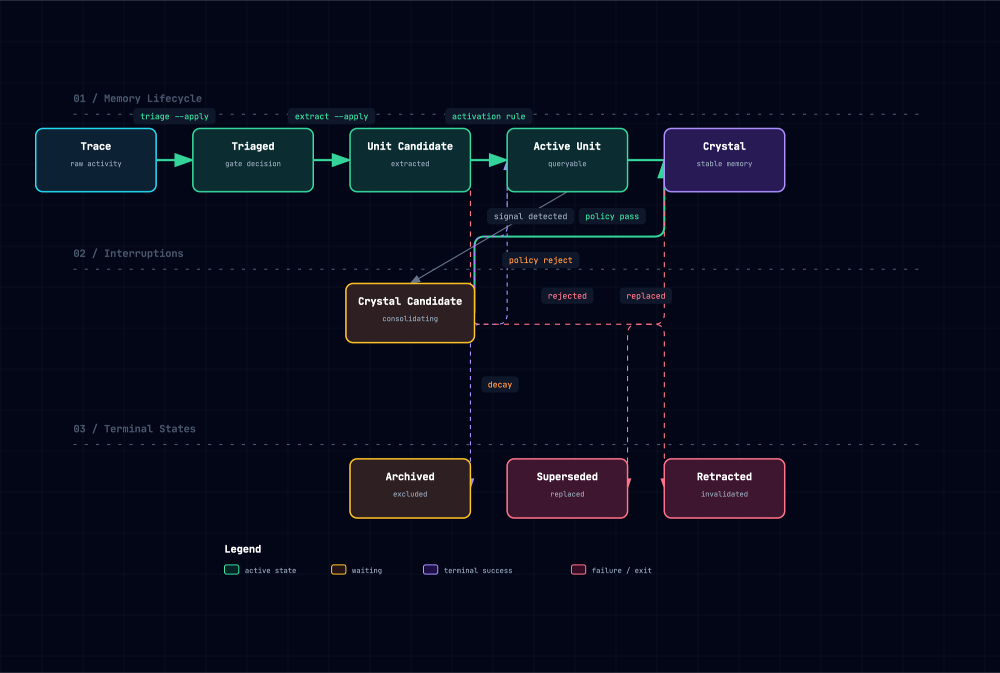
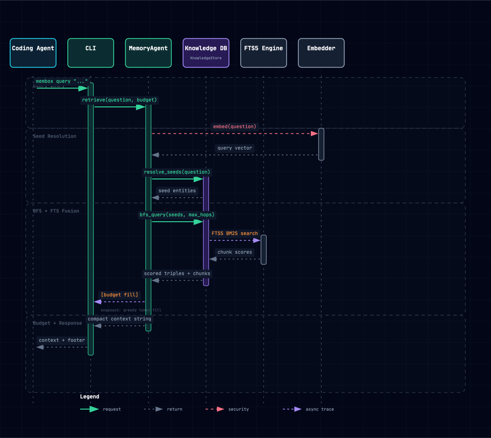
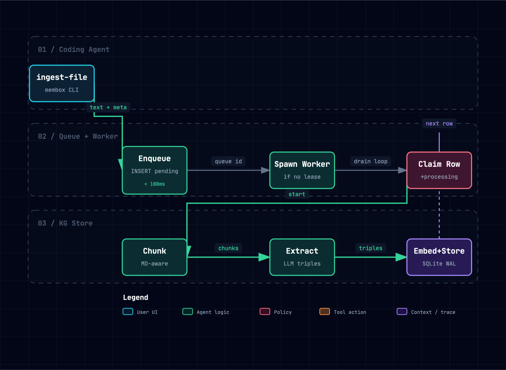

# membox

A local knowledge graph + RAG memory layer for coding agents.

Membox gives coding agents durable, project-scoped memory that survives
session restarts. It combines a knowledge graph (entities + relations with
provenance) with FTS5 full-text search and a lifecycle pipeline that turns
agent session history into reusable memory units.

**Status: pre-release (v0.1.0 stabilization in progress).**

## What it is

- **Local-first**: everything lives in a single SQLite file. No database
  server, no hosted services, no MCP/HTTP daemon.
- **Knowledge graph + FTS hybrid**: entities, relations, and source documents
  with BFS multi-hop retrieval fused with BM25 keyword search.
- **Session memory lifecycle**: `Trace → Unit → Crystal` — automatically
  extracts durable memories from agent conversation history.
- **CLI-first**: agents interact via the `membox` CLI, driven by a skill file.
- **Injectable LLM layer**: extraction and embedding go through `Protocol`s;
  tests run with deterministic fakes, production swaps in
  OpenAI/Ollama/vLLM/DeepSeek.

## What it is not

- Not a hosted service. No background daemons, no network calls except to
  the configured LLM provider.
- Not a vector database. Embeddings are optional; if absent, deduplication
  falls back to exact / casing-normalized matching.
- Not a framework. The design favors direct, readable code over abstraction.

## Diagrams

A visual tour of how membox fits together.

### System architecture


Local KG + RAG memory layer. The core runs on SQLite alone — the LLM extractor
and embedder are optional and injected through `Protocol` interfaces.

### Data flow



From raw documents to agent-ready context.

### Memory lifecycle



The `Trace → Unit → Crystal` state machine that turns raw session history into
durable memory.

### Query sequence



Hybrid BFS + FTS retrieval, fused under a token budget.

### Ingestion workflow



Async ingestion — writes are accepted in under 100 ms; LLM work is deferred to a
worker (`membox process`).

## Install

Requires Python 3.13+ and [uv](https://docs.astral.sh/uv/).

```bash
git clone <repo-url> membox && cd membox
uv sync
```

Optional LLM dependencies (OpenAI client, tree-sitter):

```bash
uv sync --extra llm
```

## Quick start

### 1. Pull session history

```bash
# Set your agent's session storage root
export MEMBOX_SESSION_ROOT=~/.pi/agent/sessions

# Auto-discover and import all sessions for the current project
membox history pull --adapt pi

# Or import a single file directly
membox history pull --adapt membox session.jsonl
```

### 2. Run the memory lifecycle

```bash
membox memory triage --apply      # classify trace items
membox memory extract --apply     # create memory units
membox memory consolidate --apply # promote crystals, supersede stale
```

Or run steps 1 and 2 in one shot with `checkpoint` (pull → triage → extract):

```bash
membox checkpoint --adapt claude   # defaults to --apply; use --dry-run to preview
```

### 3. Query memory

```bash
# Graph + FTS retrieval with memory recall
membox query "project context and key decisions" --include-memory --budget 4000

# Search session history
membox history search "migration error" --project myrepo

# Inspect memory units
membox memory list --status crystal
membox memory list --status active_unit
```

### 4. Ingest documents into the knowledge graph

```bash
membox ingest "codebase-rag is implemented in Python" --source "README.md"
membox ingest-file docs/spec.md --project myrepo
membox ingest-file .handoffs/HANDOFF.md --project myrepo

# Check async ingest queue
membox queue
membox process              # drain pending items
```

## CLI reference

### Knowledge graph

```bash
membox ingest "text" --source "source"       # ingest text (async by default)
membox ingest-file docs/arch.md --project X   # ingest a file
membox query "question" --max-hops 2 --budget 4000  # query graph + FTS
membox query "..." --include-memory           # include crystal/unit memory
membox list-entities
membox list-relations
membox process                               # drain async ingest queue
membox queue                                 # show queue status
```

### Session history (trace layer)

```bash
membox history pull --adapt pi               # auto-discover + import sessions
membox history pull --adapt codex file.jsonl  # single-file import
membox history search "query" --project X     # search history
membox history around <message-id>            # inspect context
membox history fetch <id> [--raw]             # fetch original payload
membox history file path/to/file.py           # file history
membox history failures                       # show tool errors
```

### Memory units (lifecycle)

```bash
membox memory triage --apply                 # classify trace items
membox memory extract --apply                # extract memory units
membox memory consolidate --apply            # promote crystals, decay stale
membox memory list --status crystal          # list crystals
membox memory list --status active_unit      # list active units
membox memory show <id>                      # inspect a unit
membox memory supersede <old> <new>          # replace a unit
membox memory retract <id> --reason "..."    # invalidate a unit
membox memory restore <id>                   # restore archived unit
```

### Workflow distillation

```bash
membox distill --project X --dry-run          # find repeated workflows
```

## Architecture

```
Trace → Unit → Crystal

┌─────────────────────────────────────────────────────┐
│                   CLI (Typer + Rich)                 │
│  history pull │ memory triage/extract/consolidate    │
│  ingest │ query │ distill │ queue                    │
├─────────────────────────────────────────────────────┤
│               Core (Orchestration)                   │
│  agent.py │ history_import │ triage │ consolidate    │
├─────────────────────────────────────────────────────┤
│               Store (SQLite + WAL)                   │
│  entities │ relations │ documents │ history_*        │
│  memory_units │ ingest_queue │ FTS5 sidecars         │
├─────────────────────────────────────────────────────┤
│             Services (Domain Layer)                  │
│  extraction.py │ embedding.py │ importers/           │
├─────────────────────────────────────────────────────┤
│             Providers (Protocol Adapters)            │
│  openai_compat.py (OpenAI/Ollama/vLLM/DeepSeek)      │
└─────────────────────────────────────────────────────┘
```

```
src/membox/
├── model/       Pydantic data shapes (Entity, Relation, MemoryUnit, ...)
├── core/        Storage (store/), normalization, agent, lifecycle logic
├── services/    Extraction, embedding, session importers, prompts
├── providers/   Protocol adapters (OpenAI-compatible HTTP)
└── cli/         Typer commands — presentation only
```

## Memory lifecycle

The lifecycle pipeline turns raw agent session history into durable memory:

```text
trace ──► triaged ──► unit_candidate ──► active_unit ──► crystal_candidate ──► crystal
                                                        │
                                                   archived | superseded | retracted
```

| State | Meaning | Queryable |
|---|---|---|
| **trace** | Raw session messages and tool events | `history search` only |
| **active_unit** | Extracted memory worth keeping | `memory list`, `query --include-memory` |
| **crystal** | Durable, consolidated knowledge | Default recall in `query --include-memory` |
| **superseded** | Replaced by a newer unit | Audit only |
| **retracted** | Invalidated | Audit only |

Memory types (closed taxonomy): `preference`, `decision`, `procedure`, `fact`,
`learning`, `plan`, `event`, `context`.

## Design decisions

| Decision | Rationale |
|---|---|
| SQLite + WAL + per-thread connection | Zero ops overhead; multi-process / multi-agent safe |
| Direct SQL (no ORM) | Fine-grained control over find-or-create and per-thread lifecycle |
| `Protocol`-injected extractors / embedders | Tests without live APIs; production swaps providers |
| Skill file as integration surface | Agent reads skill → calls CLI; no daemon needed |
| Heuristic triage gate | Deterministic, offline, no hidden LLM cost in tests |
| Async ingest queue (transient worker) | Fast writes; LLM extraction deferred to `membox process` |
| Token-budgeted retrieval | Honest coverage footer; no silent truncation |
| Single global DB with `project` columns | Cross-project queries; no ATTACH federation |

## Agent integration

Membox ships a **Claude Code skill** at [`skills/membox/SKILL.md`](skills/membox/SKILL.md)
(YAML frontmatter + usage guide) that teaches agents how to use the CLI. Agents
load the skill and call `membox` commands directly from the shell — no MCP
server, no HTTP endpoint.

Install the skill so an agent discovers it automatically:

```bash
# Claude Code — user-global (every project)
mkdir -p ~/.claude/skills && ln -sfn "$PWD/skills/membox" ~/.claude/skills/membox

# Claude Code — project-local (this repo only; .claude/ is gitignored)
mkdir -p .claude/skills && ln -sfn "$PWD/skills/membox" .claude/skills/membox
```

Symlinking (rather than `cp -r`) keeps the installed skill in lockstep with the
repo's `skills/membox/SKILL.md`; a copy silently drifts out of date. Other
agents: point the skill/instruction loader at `skills/membox/SKILL.md`, or paste
its contents into the system prompt.

Typical agent workflow:

```bash
# Session start — recall context
membox query "project context, key decisions, conventions" --include-memory --budget 4000

# Session end — capture this session into memory (no API key needed)
export MEMBOX_SESSION_ROOT=~/.claude/projects
membox checkpoint --adapt claude            # pull → triage → extract in one call
membox memory consolidate --apply           # periodic: promote durable crystals
```

### Try it on this repo (dogfooding)

```bash
uv sync
export MEMBOX_SESSION_ROOT=~/.claude/projects
membox checkpoint --adapt claude          # capture membox's own sessions (default: ~/.membox/membox.db)
membox query "what is the lifecycle design" --include-memory
membox memory list --status active_unit
```

The full no-API-key lifecycle (import → triage → extract) runs in a few seconds
on a real history — see [`eval/results/perf-baseline-v0.1.0.md`](eval/results/perf-baseline-v0.1.0.md).

## Development

```bash
uv run pytest                    # run tests (642 passing)
uv run ruff check src/ tests/    # lint
uv run ruff format src/ tests/   # format
uv run mypy src/                 # type check (strict)
```

All tests use deterministic fake extractors/embedders — no external API keys
required. CI runs on Python 3.13 across macOS, Linux, and Windows.

## Documentation

| Document | Content |
|---|---|
| [docs/spec/spec_01_core.md](docs/spec/spec_01_core.md) | Knowledge graph + RAG core spec |
| [docs/spec/spec_02_memory_lifecycle.md](docs/spec/spec_02_memory_lifecycle.md) | Memory lifecycle spec (Trace → Unit → Crystal) |
| [docs/roadmap.md](docs/roadmap.md) | Implementation roadmap and current status |
| [docs/code-standards.md](docs/code-standards.md) | Coding style and conventions |
| [skills/membox/SKILL.md](skills/membox/SKILL.md) | Agent skill file (CLI usage instructions) |

## License

MIT
